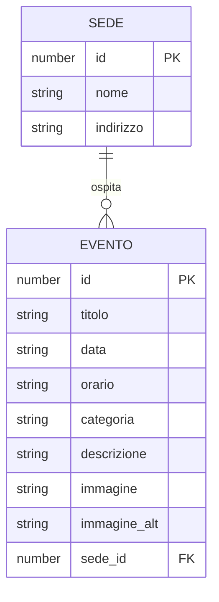

# Schema dei dati — Segnale

## Entità e campi

### Evento

Un evento è un appuntamento del programma.

| Campo | Tipo | Esempio |
|---|---|---|
| `id` | numero | `1` |
| `titolo` | testo | `"Lettere in movimento"` |
| `data` | testo, formato `YYYY-MM-DD` | `"2026-06-12"` |
| `orario` | testo, formato `HH:MM` | `"10:00"` |
| `categoria` | testo | `"Incontro"` |
| `descrizione` | testo | `"Un incontro su tipografia, ritmo e comunicazione visiva."` |
| `immagine` | testo, percorso del file | `"assets/lettere-in-movimento.svg"` |
| `immagine_alt` | testo | `"Lettere geometriche disposte su una griglia"` |
| `sede_id` | numero | `1` |

### Sede

Una sede è un luogo in cui si svolgono gli eventi.

| Campo | Tipo | Esempio |
|---|---|---|
| `id` | numero | `1` |
| `nome` | testo | `"Officina Nord — Sede centrale"` |
| `indirizzo` | testo | `"Corso Duca degli Abruzzi 24, Torino"` |

## Chiavi e relazione

`Evento.id` e `Sede.id` sono chiavi primarie: sono numeriche, univoche nella rispettiva entità e stabili.

`Evento.sede_id` è una chiave esterna che fa riferimento a `Sede.id`. Una sede può ospitare più eventi; ogni evento si svolge in una sede.

## Quantità e aggiornamento

I dati comprendono **6 eventi e 3 sedi**. Chi cura il sito aggiorna gli oggetti nei file `dati/eventi.json` e `dati/sedi.json` nella repository, poi pubblica le modifiche.

## Che cosa mostra la pagina

La pagina Programma carica gli eventi e le sedi dai file JSON e mostra per ogni evento titolo, data, orario, categoria, descrizione, immagine e nome della sede collegata. La pagina Info e luoghi presenta le sedi e le informazioni per raggiungerle.

## Schema Evento–Sede

